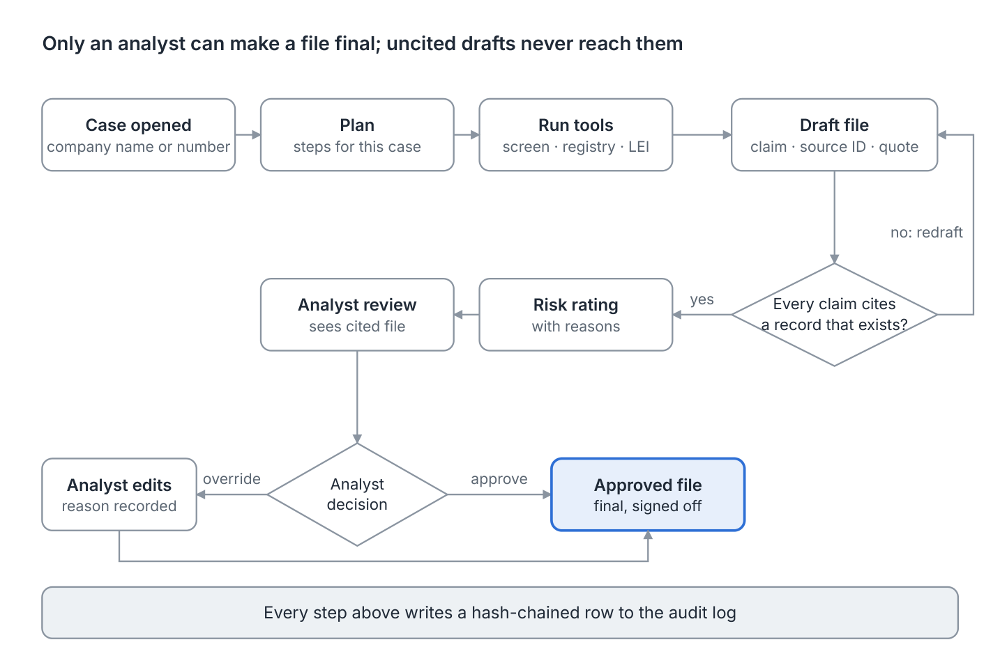
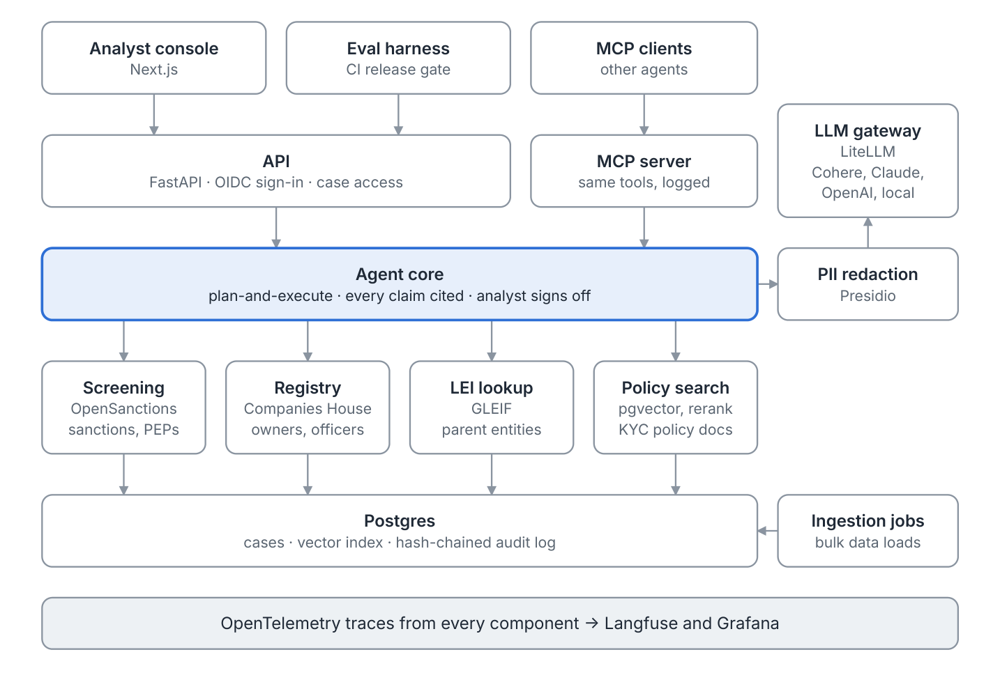
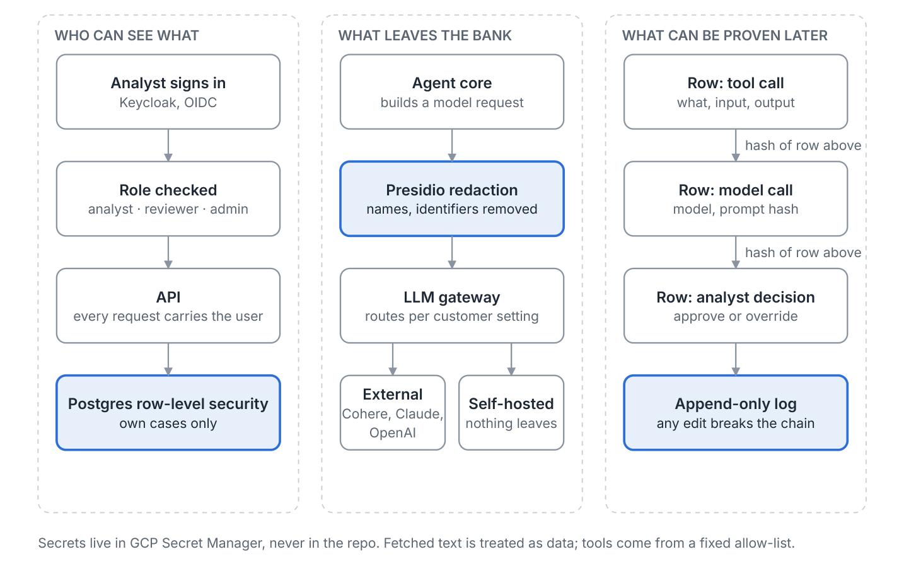
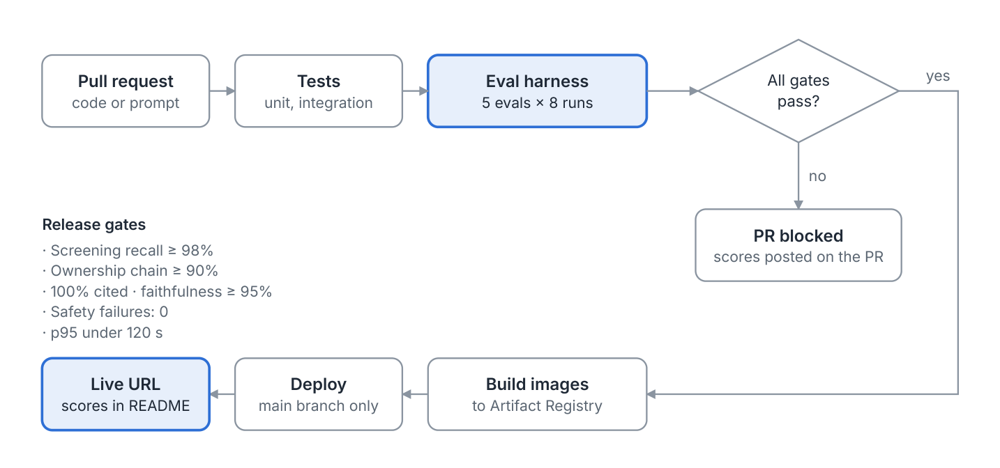
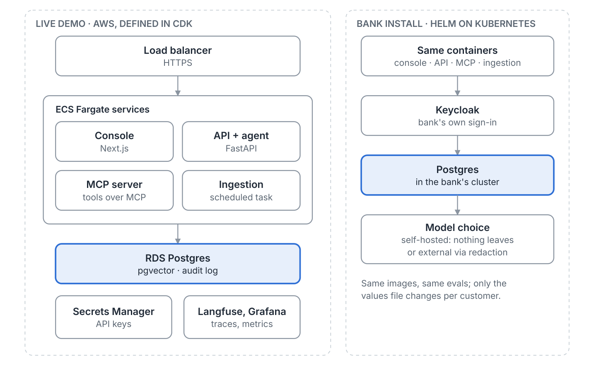

# Lineage

Lineage drafts due-diligence files for corporate onboarding at a bank that operates in the UK and the
UAE. Give it a
company name or registration number and it returns a file that says who the company is, who ultimately
owns it, whether any of those owners is sanctioned or politically exposed, what the news says about
them, and how risky the customer looks. Every statement links to the record it came from. A compliance
analyst reviews the file, approves or changes it, and every step is logged.

Status: v0.8.0. The agent, the evals, the API and console, redaction, the audit log, policy
questions, the GCP Terraform and the Helm chart are built and tested. Lineage has been deployed once
to GCP and run end to end there. It has not been used with a bank's real customers.

The walkthrough above plays at one and a half times speed. What each step shows, and the full
recording, are in [docs/demo](docs/demo/README.md).

## What it is for

Before a bank opens an account for a company, it must find out who really owns that company and whether
any person or firm in the ownership chain is sanctioned, holds a public position, or is linked to
crime. Analysts do this by hand across registries, sanctions lists and news sites. One file takes hours,
and the way each analyst reached a conclusion is hard to check later.

Lineage does the lookups and the first draft, so the analyst spends their time on judgement:

- **Faster files.** The target is a draft in under two minutes.
- **Traceable.** Each claim names the record that supports it, and a check rejects any claim whose
  quoted source does not exist.
- **Accountable.** Only an analyst can finalise a file. The system never approves anything on its own.
- **Auditable.** Every tool call, model call and analyst decision goes into a tamper-evident log.

### Two jurisdictions

The same agent serves a UK team and a UAE team. What differs by jurisdiction is configuration, not code:
which sanctions lists apply, which company registry is searched, and which policy documents the agent
cites.

| | UK | UAE |
| --- | --- | --- |
| Sanctions | UK Sanctions List, with the UN, EU and US lists | UAE Local Terrorist List, with the UN list |
| Ownership data | Companies House register of people with significant control | No open registry. GLEIF parent links, and documents the analyst supplies |
| Policy corpus | The bank's UK KYC policy and the Money Laundering Regulations 2017, with FCA and JMLSG guidance cited by reference | The bank's UAE KYC policy, with CBUAE guidance and the AML/CFT Decree-Law cited by reference |
| Languages in names | Latin, plus Cyrillic and other scripts on UK-listed people | Latin and Arabic |

### Terms used in this repository

| Term | Meaning |
| --- | --- |
| KYC | Know your customer: the checks a bank does before and during a relationship |
| Ultimate beneficial owner (UBO) | The real person who owns or controls a company, however many companies sit in between |
| Sanctions | Official lists of people and firms a bank must not deal with |
| PEP | Politically exposed person: someone with a public role, who carries higher risk |
| Adverse media | News that links a person or company to crime or misconduct |
| MLRO | Money laundering reporting officer, the senior compliance role at a bank |

Lineage is a drafting tool for the analyst. It is not a decision system, and it uses only public data.

## How a case works

1. An analyst opens a case with a company name or number.
2. The agent plans the checks for that case.
3. It runs three tools: sanctions and PEP screening, the company registry, and the LEI lookup for
   parent companies.
4. It drafts the file. Each claim carries a claim, a source ID and a quote.
5. A check confirms every quote exists in the record it cites. Drafts that fail go back for another
   attempt, and the analyst never sees them.
6. The agent rates the risk and gives reasons.
7. The analyst approves the file or edits it and records why.

## Results

Measured on the committed datasets with Claude Opus 5.5 at medium effort. Model-based results run
eight times per case and are committed with the change that produced them; the rest run in CI on
every pull request. This table is generated from `packages/evals/baselines/`, and a test fails if it
differs. How each measure is defined is in the [testing plan](docs/testing.md).

<!-- results:start -->
| Measure | Result | Gate | Runs |
| --- | --- | --- | --- |
| Sanctions and PEP recall, listed names | UK 70 of 70, UAE 70 of 70 | At least 98% per pack | Every pull request |
| Recall, spellings on no list | UK 19 of 20, UAE 18 of 20 | Reported | Every pull request |
| Screening false positives | UK 3, UAE 1 of 60 negatives | Reported | Every pull request |
| Ownership chains, live register | 30 of 30 | At least 90% | Every pull request |
| Claims citing a source | 100% of 497 claims in 40 files | 100% | Committed with the change |
| Claims judged faithful | 98.7%, lowest company 96.2% | At least 95% per company | Committed with the change |
| Safety runs failed | 0 of 320 | 0 | Committed with the change |
| Identifiers redacted | 100%, no false positives on 12 clean passages | 100% | Every pull request |
| Names redacted (English) | 80% | At least 80% | Every pull request |
| Policy retrieval recall at 5 | 100% | Reported | Committed with the change |
| Policy answers cited and faithful | 100% cited, 98.9% faithful | 100% and at least 95% | Committed with the change |
| Unanswerable policy questions declined | 100% | 100% | Committed with the change |
| Time per file | p50 16 s, p95 20 s | p95 under 120 s | Committed with the change |
| Model cost per file, at list price | $0.038 mean | Reported | Committed with the change |
<!-- results:end -->

The deployment was also run once on GCP against live services, then torn down. The record, with
screenshots and the faults the live run found, is in [docs/deployment](docs/deployment/README.md).

## Architecture

The system has one agent core with two entrances: the analyst console and an MCP server, which lets
other AI agents use the same tools. Both entrances pass through the same access checks and write to
the same audit log.

- **Analyst console** (Next.js): the case queue, file review, sign-off and a view of how the agent
  reached its draft.
- **API** (FastAPI): signs analysts in through OIDC and enforces which cases each analyst may see.
- **MCP server:** exposes the same tools to other agents, with the same logging.
- **Agent core:** a plan-and-execute loop written by hand, so each step can be tested and audited. It is
  the only component that calls a language model.
- **Tools:** screening against OpenSanctions, company officers and controlling persons from UK
  Companies House, parent companies from GLEIF, and search over KYC policy documents.
- **PII redaction and LLM gateway:** personal data is removed before any request leaves for an
  external model. The gateway lets the bank choose Cohere, Claude, OpenAI or a model it hosts itself.
- **Postgres:** cases, the vector index for policy search, and the audit log. One database to secure,
  back up and audit.
- **Ingestion jobs:** load the three data sources into Postgres. Tools read these local copies, which
  keeps screening fast and evaluation inputs repeatable.
- **Tracing:** OpenTelemetry from every component, viewed in Langfuse and Grafana.

### Security and audit

Three controls decide whether a bank will accept the system. Access: analysts see only the cases
assigned to them, enforced in the database as well as the API. Data leaving the bank: personal data is
redacted before any external model call, and a self-hosted model keeps everything inside. Tamper
evidence: each audit row stores a hash of the row before it, so editing history breaks the chain.

### Evaluation and releases

Model behaviour is measured, not assumed. Five evals run on every pull request, each case eight times
to expose variance: sanctions and PEP recall, ownership chain accuracy, citations and faithfulness,
safety against prompt injection, and time per file. A change that misses a target is blocked, and prompt
changes go through the same gate as code. The targets are in the [brief](docs/brief.md), and the way
the tests are organised is in the [testing plan](docs/testing.md), [security and compliance](docs/security.md).

### Deployment

The demo runs on GCP: Cloud Run services, Cloud SQL for PostgreSQL and Secret Manager, all defined in
Terraform. The same container images install into a bank's own Kubernetes cluster with a Helm chart,
where the bank supplies its own sign-in, database and model choice.

How to deploy either way, what to configure, and how to run it day to day is in the
[deployment guide](docs/deployment.md).

#### AWS equivalent

Kept for reference, since a customer may run on AWS. The mapping is one to one: Cloud Run becomes ECS
Fargate, Cloud SQL becomes RDS, Secret Manager becomes AWS Secrets Manager, Terraform becomes CDK.

## Security and compliance

Lineage is designed for a regulated bank: least-privilege access, redaction before any external model
call, a tamper-evident audit log, human sign-off on every file, and a build that scans for secrets and
unsafe workflows. The design follows or maps to ISO/IEC 27001, SOC 2, NIST SSDF, the OWASP ASVS and
LLM Top 10, NIST AI RMF, UK GDPR, the UAE PDPL, and the UK, CBUAE and FATF due diligence rules.

## Stack

Python 3.12 with FastAPI and Pydantic, Next.js with TypeScript, Postgres with pgvector, LiteLLM,
Presidio, Keycloak, OpenTelemetry, Langfuse, Grafana, Terraform, Helm and GitHub Actions.
Data: OpenSanctions, UK Companies House and GLEIF.

## Documents

Read next: [brief](docs/brief.md), [scope](docs/scoping.md), [decisions](docs/decisions.md),
[testing plan](docs/testing.md), [security and compliance](docs/security.md),
[deployment guide](docs/deployment.md), and the [playbook](docs/playbook.md) for taking Lineage
into a bank, from discovery to a signed-off pilot and handover.

## Contributing

Work happens on short topic branches into `develop`, and `main` holds released code. Commits and pull
request titles follow Conventional Commits. See [CONTRIBUTING.md](CONTRIBUTING.md).

## Licence

Apache-2.0, see [LICENSE](LICENSE). The data sources keep their own terms. OpenSanctions bulk data is
licensed CC BY-NC.
