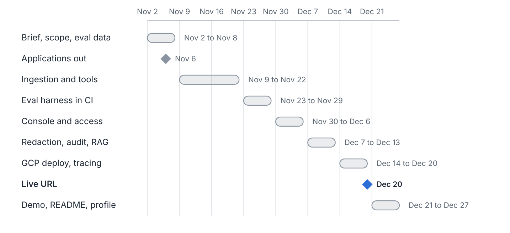

# Lineage

Due-diligence drafting for corporate onboarding at a national bank in the UAE.
Given a company name or registration number, Lineage drafts a cited KYC file: resolved entity,
ownership chain to ultimate beneficial owners, sanctions/PEP hits, adverse media, and a risk
rating. An analyst approves or overrides it; every step is logged.

Stack: Python/FastAPI backend, Next.js console, Postgres (pgvector), deployed on GCP
(Cloud Run + Cloud SQL, Terraform). Data: OpenSanctions, UK Companies House, GLEIF.

Scope and release gates: [docs/brief.md](docs/brief.md) · [docs/scoping.md](docs/scoping.md) · [docs/decisions.md](docs/decisions.md)

## System architecture

Every model call is redacted first; every step is traced and audited. The agent core is the only
component that calls models, always through redaction.

## Agent run

Only an analyst can make a file final; uncited drafts never reach them.

## Security and audit

Three controls a bank will test: access, data egress and tamper evidence.

## Evals and CI/CD

A release that misses any eval gate never reaches production. Prompt changes go through the same gate as code.

## Deployment

The demo runs on GCP: Cloud Run services, Cloud SQL for PostgreSQL, Secret Manager, all defined in
Terraform. The same container images run as an in-house install for a bank; only the values file changes.

### AWS equivalent

Kept for reference, since a customer may run on AWS. The mapping is one to one: Cloud Run becomes
ECS Fargate, Cloud SQL becomes RDS, Secret Manager becomes AWS Secrets Manager, Terraform becomes CDK.

## Delivery plan

About 12 hours a week from 2 November 2026; live URL on 20 December.

