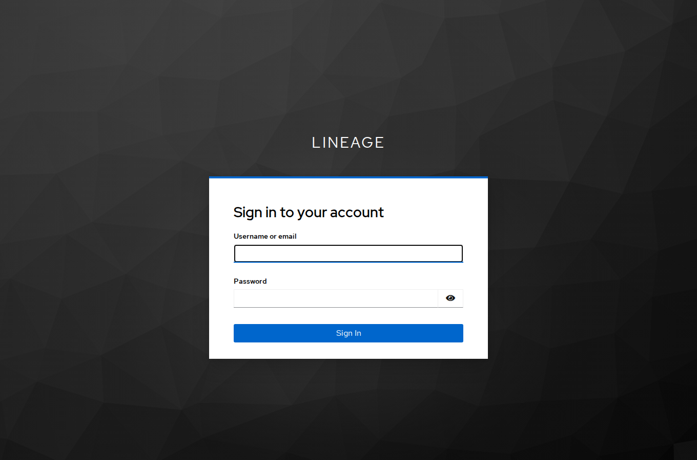
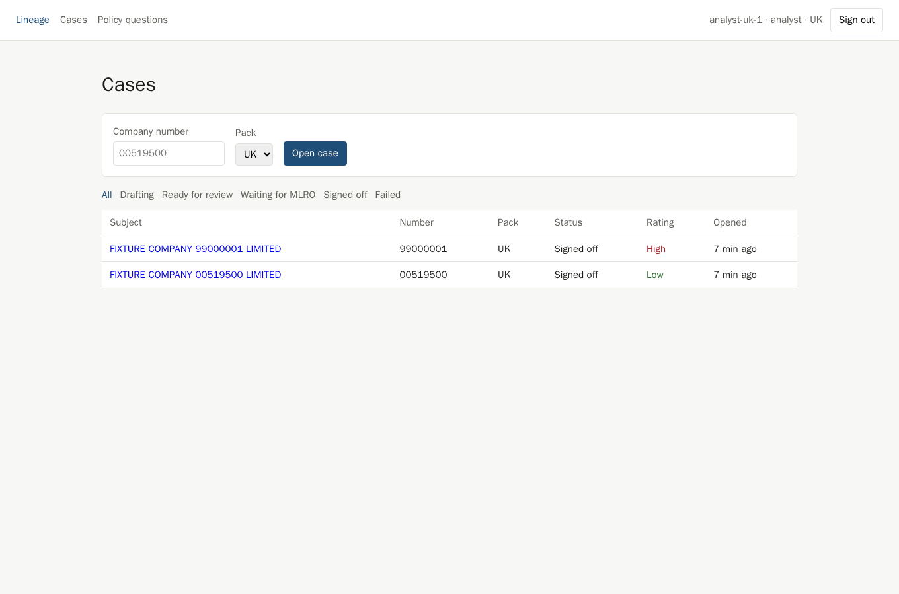
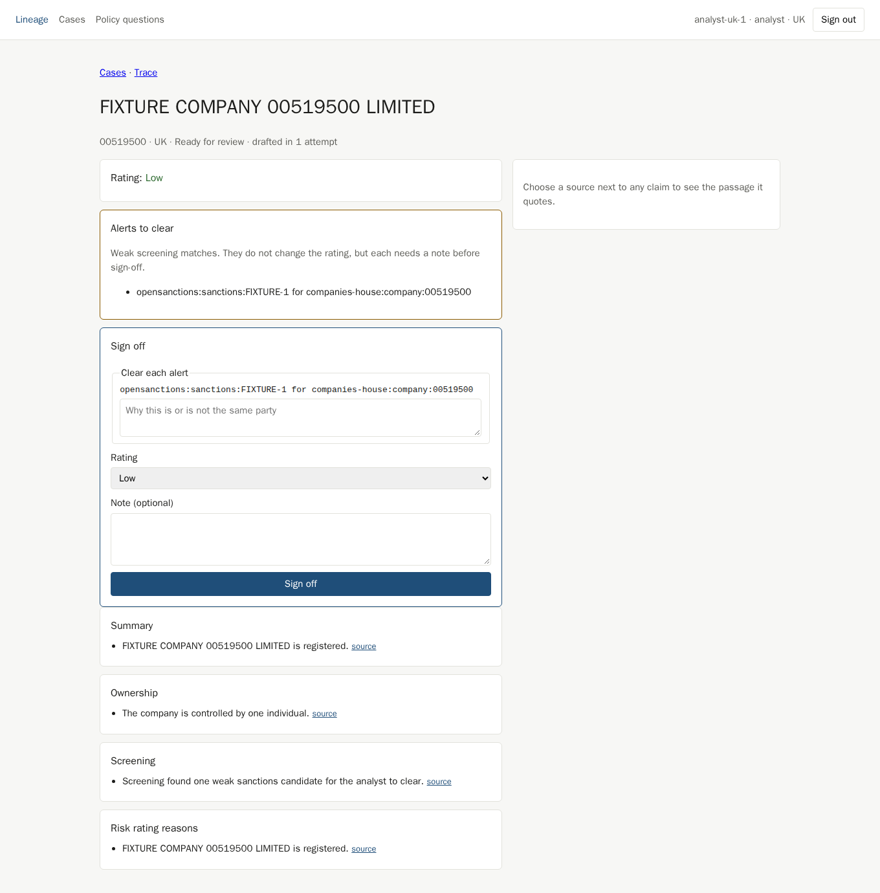
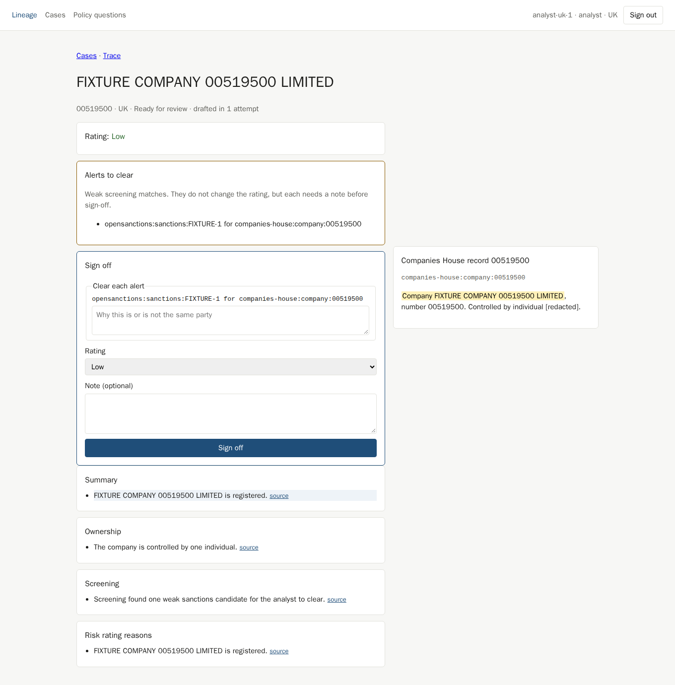
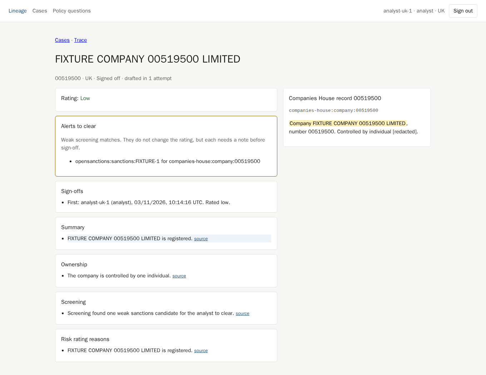
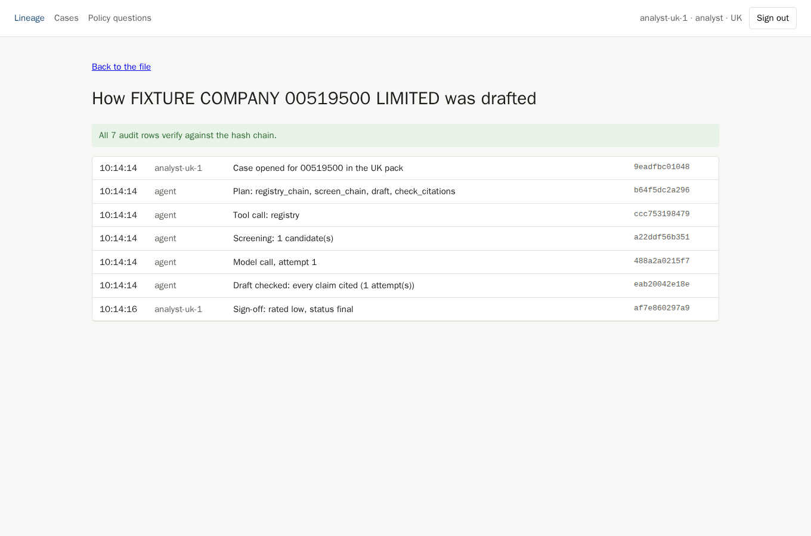
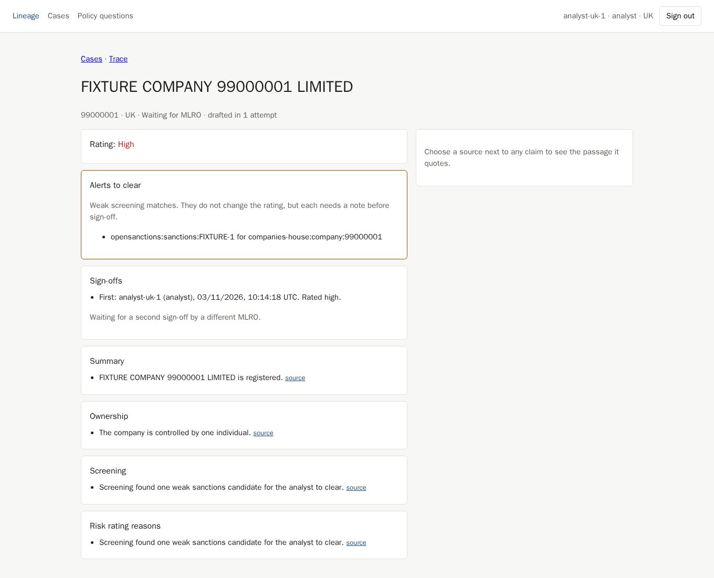
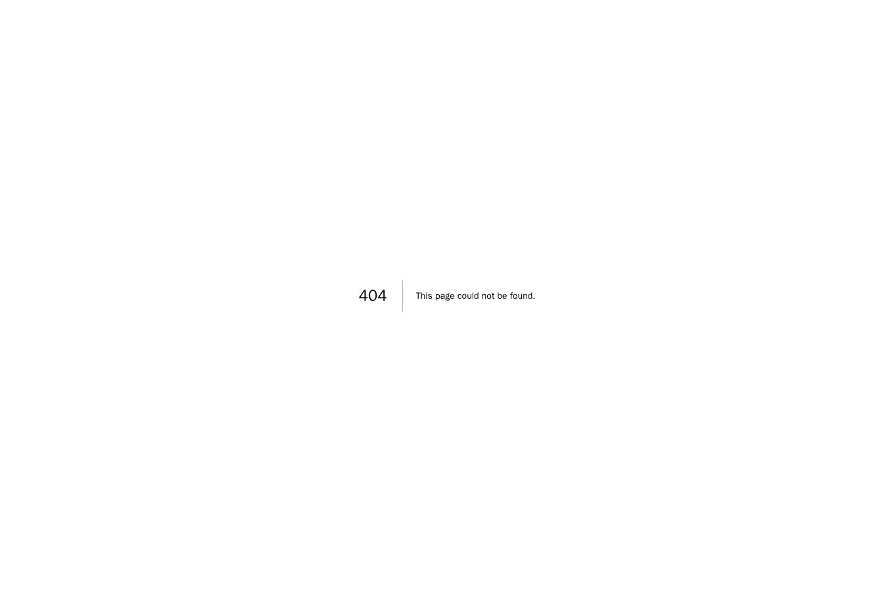
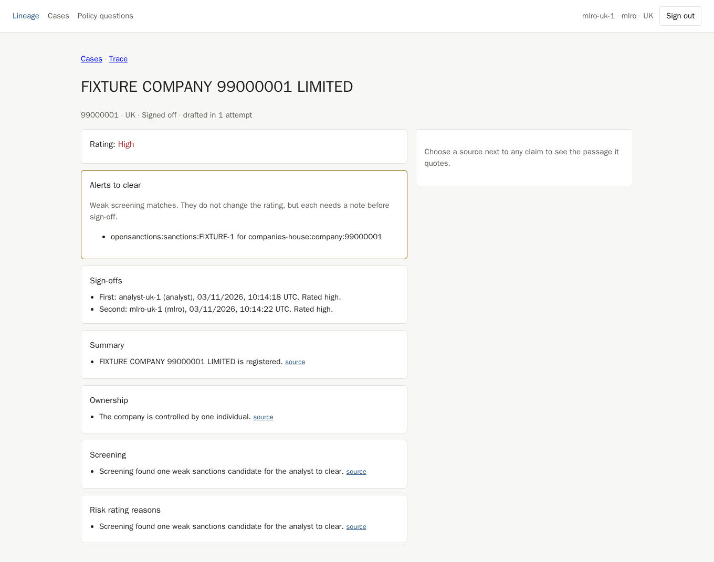
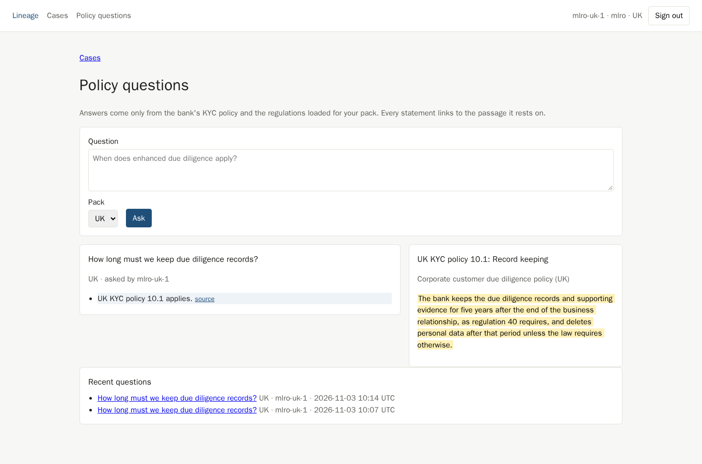

# One deployment to GCP, recorded

On 3 November 2026 the Terraform in `infra/terraform` was applied once to a GCP project, the full
flow was run against the live services, and everything was then destroyed. This page records what
was deployed, what was checked, and what the live run found that local testing had not.

## What was deployed

`terraform plan` proposed 68 resources to add, 0 to change and 0 to destroy, all new and all named
`lineage-…`, in their own VPC, so nothing in the project was touched.

| Service | Detail |
| --- | --- |
| Console | Cloud Run, `europe-west2` |
| API | Cloud Run, direct VPC egress to Cloud SQL |
| Keycloak 26.8.0 | Cloud Run, one warm instance, realm imported from a secret file, random passwords |
| Database | Cloud SQL Postgres 17, private IP only, `db-custom-1-3840`, encrypted connections, pgaudit |
| Ingestion | Cloud Run job, started by Cloud Scheduler |

Release v0.7.1, with drafting from fixtures (`drafting = "fixture"`), since no Anthropic API key was
used. Screening, ownership and policy retrieval ran on real data; the drafted text is canned.

## What was checked

| Check | Result |
| --- | --- |
| Migrations on Cloud SQL, including pgvector, row-level security and the audit chain trigger | All ten applied on first start |
| First load | 14,610 sanctions and PEP records, 104,590 screening names, 66 policy sections |
| Health | API `/health/ready` 200, Keycloak discovery 200, console sign-in redirect 307, each under a second |
| Browser walkthrough against the live URLs | Passed in 16 seconds, screenshots below |
| Whole audit chain, checked inside the VPC by the ingestion job | `audit chain verified: 36 rows` |

The walkthrough signed in through Keycloak, opened a low-rated case, opened a cited source, cleared
the alert, signed off, and checked the trace. It then opened a high-rated case, which waited for an
MLRO; another analyst got a 404 for it; an MLRO gave the second sign-off. Finally it asked a policy
question and opened the cited passage.

| | |
| --- | --- |
|  |  |
|  |  |
|  |  |
|  |  |
|  |  |

## What the live run found

Six faults that every local and CI test had passed. Each is fixed in this change.

1. **Container ports.** Cloud Run sends traffic to port 8080. The API listens on 8000 and the
   console on 3000, so the first API revision never became ready.
2. **Session cookie size.** With real issuer addresses, the three tokens sealed into the session
   cookie passed the browser's 4 KB limit, so sign-in looped. The console no longer keeps the ID
   token and signs out by client id instead.
3. **Keycloak cold starts.** Keycloak opens its port about 30 seconds before it can serve, and
   answered 503 meanwhile. It now keeps one warm instance, is probed on `/health/ready`, and runs
   its cache in local mode.
4. **Cached discovery failure.** The console kept a failed discovery request forever, so one 503
   during Keycloak's start left sign-in broken until the console restarted. A failure is now
   forgotten and retried.
5. **Server actions behind a proxy.** `Referrer-Policy: no-referrer` makes browsers send
   `Origin: null` on form posts, and Next.js refused every server action behind Cloud Run's proxy.
   The policy is now `same-origin`, which still sends nothing to other sites.

6. **Empty policy corpus.** The API image did not include `policies/`, so the corpus loaded nothing
   and every policy question came back unanswered. The image now ships the policies, and the loader
   fails if it finds none.

Images were built from the `v0.7.1` tag rather than pulled from GitHub Packages, because the
machine's GitHub login could not read packages. The console fixes above were deployed as interim
tags while the run was in progress.

## Teardown

Before applying, the project's enabled APIs, IAM policy, service accounts, networks, subnets,
addresses, firewall rules, instances and disks were recorded. After the run:

- `terraform destroy` removed every resource. Cloud SQL's users and databases cannot be dropped
  while they own objects, so the instance was deleted with them inside it. Google holds Cloud Run's
  egress address and the private service connection for a while after deletion: the address was
  released within about two hours, and the service networking peering was deleted directly.
- The ten APIs switched on for the deployment, including four Google enabled as dependencies, were
  disabled, and the service agent grants Google added to the IAM policy were removed.
- A second snapshot matched the first exactly: the same APIs, IAM policy, service accounts,
  networks, subnets, addresses, firewall rules, instances and disks.
